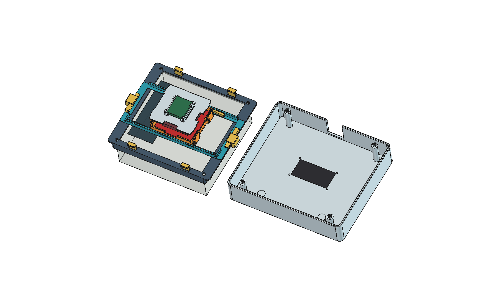
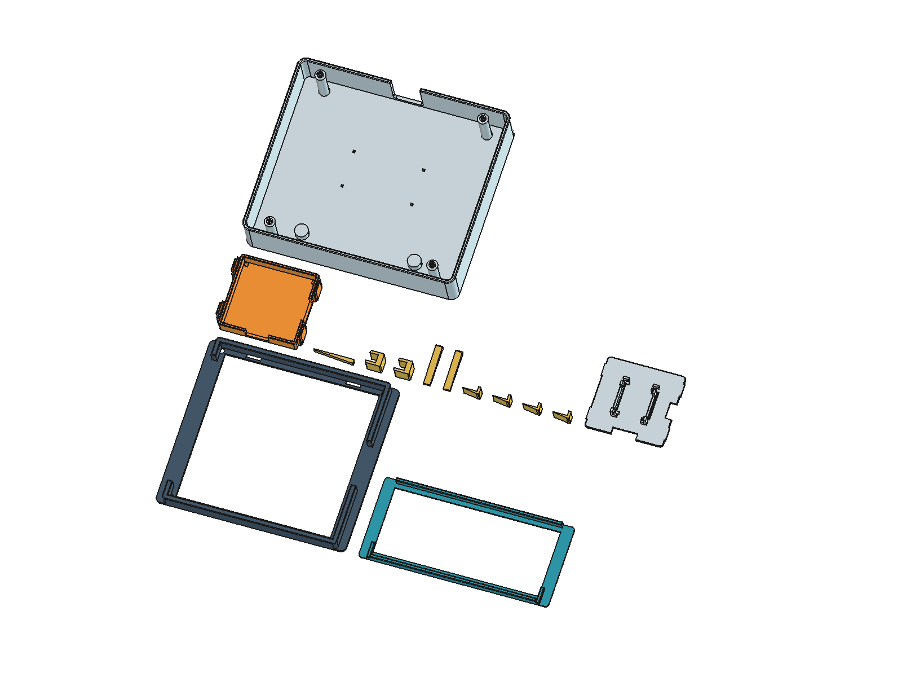
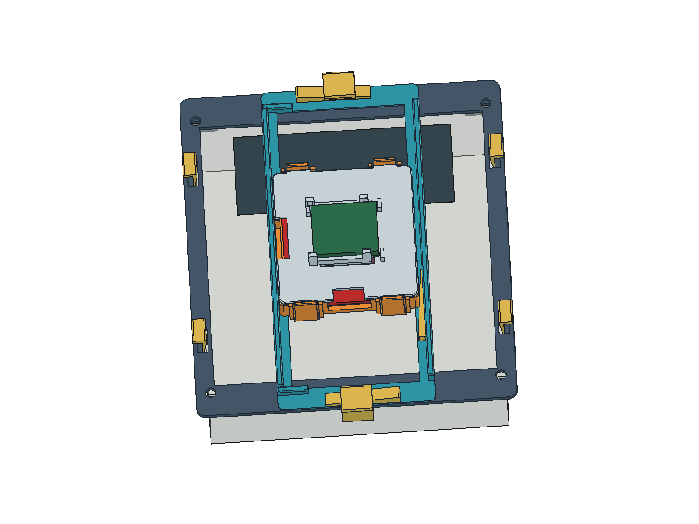
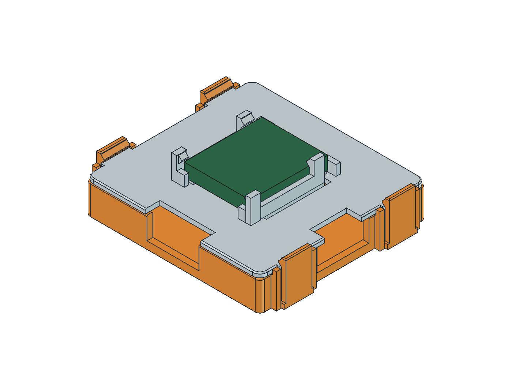
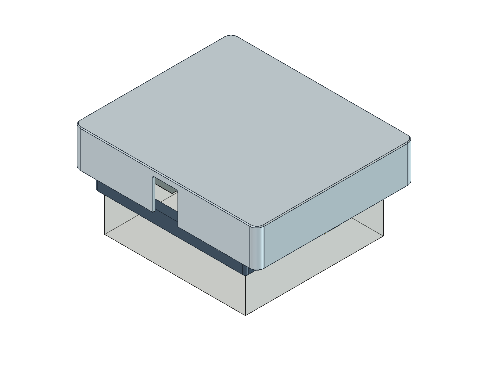

# NFC water meter enclosure v1.3 — printing and assembly

This guide accompanies the files in
[`hardware/vesimittari_v1_3/`](../hardware/vesimittari_v1_3/README.md).
Original Finnish part filenames are retained; English names are given below.
All dimensions are in **millimetres**.

> **Prototype / fit-check required.** The design report contains geometric checks,
> not measured print strength, snap force, fatigue life, or a completed physical
> v1.3 fit test. Do not force parts onto a meter or PCB. This is not a sealed or
> IP-rated enclosure. Do not open the water meter, disturb seals, or alter plumbing.

## 1. Check compatibility before printing

| Item | Modelled size or allowance |
|---|---|
| Water meter reference outline | 98 × 96 mm; simplified shape, not a manufacturer-specific guarantee |
| Saddle inner opening | 99.2 × 97.2 mm, with 8 mm skirt |
| NFC PCB | 42.6 × 40.5 mm; PCB thickness assumed to be 1.6 mm |
| NFC pocket clear opening | 43.8 × 41.7 mm |
| NFC component envelope | 6 mm measured from the PCB underside; nominal 0.8 mm clearance to the cover |
| ESP32-C3 board envelope | **17.8 × 21 × 3.5 mm** including its relevant components |
| ESP32 side-guide opening | 18.6 mm |
| NFC PCB underside above the meter's display plane | Nominally 3.6 mm |
| Optional external Wi-Fi antenna | 40 × 20 mm adhesive antenna; 70 mm coax modelled |
| Suggested adjustment | X ±20 mm, Y ±16 mm |
| Outer cover footprint | 128 × 110 mm |
| Enclosure height reference | Roof 28 mm above the modelled display plane; assembled CAD envelope height 36 mm |

Measure the real meter, PCB outline, soldered wires, connectors, and component
heights. Meter corner radii, hinge protrusions, and latch protrusions were not
fully measured. The model's 35 mm meter-height parameter is the reference display
height above a cabinet surface, **not the complete meter height**.

The firmware's `esp32-c3-devkitm-1` board ID does **not** mean a physical DevKitM
board fits this holder. This enclosure is dimensioned for the compact board
envelope above. Change the CAD parameters for a larger board.

An external antenna is optional and only appropriate for an ESP32 board with a
compatible external-antenna connection and the correct hardware configuration.
Do not attach a coax cable to an arbitrary GPIO or assume every ESP32-C3 supports it.

## 2. Parts and tools

### Printed parts — complete enclosure

Print the listed quantity of each STL; one STL does not necessarily mean one copy.
The numbering intentionally skips 09 to match the source design.

| STL filename in `hardware/vesimittari_v1_3/stl/` | English name | Quantity |
|---|---|---:|
| `01_Satula.stl` | Meter saddle / adapter frame | 1 |
| `02_Poikittaiskelkka.stl` | Y carriage with X guide rails | 1 |
| `03_NFC_kelkka.stl` | NFC tray with four cover snap arms | 1 |
| `04_X_kiila.stl` | X-position friction wedge | 1 |
| `05_C_puristin.stl` | Y-position C-clamp | 2 |
| `06_Y_kiila.stl` | Y-clamp tightening wedge | 2 |
| `07_Sovituskiila.stl` | Meter-fitting wedge | 4 |
| `08_Kansi.stl` | Outer protective cover | 1 |
| `10_NFC_kansi_ESP_pidike.stl` | Snap-on NFC lid with integrated ESP32 holder | 1 |
| **Total** | **9 part types** | **14 pieces** |

The two C-clamps use the same STL; rotate one into the opposing position during
assembly. The same applies to the two Y wedges. Do not create mirrored versions
unless you intentionally modify the design.

### Electronics and tools

- PN532 NFC PCB and compact ESP32-C3 board that fit the envelopes above.
- A suitable stable supply, USB cable, and power/GND/SDA/SCL wiring.
- Optional compatible 40 × 20 mm Wi-Fi antenna and coax lead.
- Calipers, flush cutters/deburring tool, and a small nonconductive tool for
  gently releasing clips. Use a soldering iron only if your electronics require it.

No metal screws or nuts are specified for the modelled locks. The outer cover
uses split friction pins, not screw threads; do not drive screws into those pins.

## 3. Printing

Recommended starting point from the original design notes:

- **PETG**, 0.4 mm nozzle, 0.2 mm layers, at least **3 wall lines**.
- **100% scale**, interpreted as mm in the slicer. Do not globally scale the model
  to compensate for an isolated fit issue; that also changes PCB and meter dimensions.
- The exported STLs are already oriented for printing. Supports are not intended
  for the modelled snap features; inspect the slicer preview before printing.
- Print the saddle first to check meter fit. Print parts 03 and 10 next to test
  the snap geometry before committing to the rest of the enclosure.

| Part | Intended bed contact / orientation |
|---|---|
| 01 | Upper frame face against the bed; skirt walls grow upward |
| 02 | Flat ring/base on the bed |
| 03 | Thin flat bottom on the bed; snap arms upward |
| 04 | Flat bottom on the bed |
| 05 | Side face of the C-profile on the bed |
| 06 | Flat bottom on the bed |
| 07 | Broad side/profile on the bed |
| 08 | Broad outer roof face on the bed, open interior upward |
| 10 | Flat underside on the bed, ESP32 holder upward |

`Tulostusosat.FCStd` shows all 14 pieces in print orientation, but its arrangement
does not represent a particular printer bed. Arrange copies to suit your slicer.

The spring arms are nominally **1.2 mm** thick. Keep their U-shaped relief slots
(nominally **0.8 mm**) open. Remove stringing and first-layer elephant foot from
sliding/clip surfaces. Do not glue or fill the spring slots. Different PETG brands
and printer tolerances can change fit; the recommendation is not a strength guarantee.

## 4. Fit the saddle to the meter

1. With electronics disconnected, place part **01** over the intended meter
   outline. Orient its larger/smaller side openings to clear the real hinge and
   latch as appropriate. Verify that it seats without loading the display or seals.
2. Check the skirt, corners, and any protrusions. If there is interference, stop
   and adjust the CAD rather than forcing the frame onto the meter.
3. Insert the four **07** fitting wedges from above into the frame's four wedge
   slots. Their tapered faces take up clearance between the skirt and meter.
4. Tighten gradually and evenly by hand, only enough to prevent movement. The
   render deliberately shows these wedges raised before tightening.

The frame must not deform the meter, obstruct servicing, or interfere with utility seals.

## 5. Fit the adjustable carriage

1. Place part **02** on the saddle. Its end ears sit on the saddle and allow the
   carriage to move in **Y**, approximately ±16 mm from the centre position.
2. Fit one **05** C-clamp around the frame/carriage stack at each end. Rotate the
   second clamp to the opposing side, as shown in the CAD.
3. Insert a **06** wedge beneath each clamp's upper arm to take up clearance.
   Leave both loose enough for initial positioning; final tightening is by hand.
4. Place part **03** in the open X guide of part 02, with its flat bottom toward
   the meter. Check that it slides freely over the intended **X ±20 mm** range.
   Do not force it past the modelled end stops.
5. Fit **04** between the NFC tray and the rear guide surface. It is a tapered
   friction wedge; leave it loose until the best antenna position is established.

## 6. Install the PN532 and snap-on lid

1. Disconnect power. Place the PN532 PCB in tray **03**, with its **antenna side
   facing the meter**. Check the small edge supports and underside component space.
2. Route wires through the tray's front or side notch and the matching lid notch.
   Keep them above the sliding guides and clear of all four snap arms.
3. Align lid **10** with the tray's side tabs and guides. The lid's tabs fit under
   the tray's four outward-flexing hooks.
4. Press evenly around the edges until all four tabs are retained. Do not press
   directly on the PCB or bend a single arm excessively.
5. Check that the lid sits evenly and wires are not trapped. Nominal cover-clip
   clearances are 0.4 mm sideways and 0.25 mm vertically, with 0.45 mm retention overlap.

## 7. Install the ESP32-C3

1. **Unplug the USB cable before fitting the board.** Identify the USB-end fixed
   hooks and the flexible hooks at the opposite end of the holder on part 10.
2. Tilt the board approximately **20–22°** and slide the USB end underneath the
   two fixed hooks first.
3. Lower the opposite end. Gently ease the flexible arms sideways if needed until
   the board is captured. The hooks must bear on suitable PCB edges, not components,
   antenna structures, or soldered wires.
4. Confirm that the board is supported, its components do not touch the lid,
   and the USB plug can be inserted without levering the board out of the holder.

The nominal side clearance is 0.4 mm per side, vertical clearance 0.35 mm, and
hook overlap 0.45 mm. These are design values, not measured print tolerances.

## 8. Wire and route cables

The repository's example firmware uses the following I²C signals:

| ESP32-C3 | PN532 |
|---|---|
| GPIO6 | SDA |
| GPIO7 | SCL |
| GND | GND |
| Correctly rated supply | Module power input |

Set the PN532 breakout to **I²C mode** according to its own documentation. The
expected 7-bit address is `0x24`. ESP32 GPIO logic is **3.3 V and not 5 V tolerant**;
check the breakout's power requirements and I²C pull-up voltage before connecting.

Keep wires out of rails, wedges, spring slots, and cover friction pins. Leave enough
slack for full carriage movement and for disconnecting the cover. The model includes
space for a 550 mm NFC lead, but that is a routing allowance—not a recommendation
to make I²C wiring unnecessarily long. Check actual bus reliability with your cable.

If using a compatible external Wi-Fi antenna, mount it on the marked **40 × 20 mm**
flat area inside the outer cover. Route the coax with broad bends and no tension at
the connector. The supplied report gives a 36.0 mm centre-position route and up to
57.3 mm at the checked extremes, leaving at least 12.7 mm from a nominal 70 mm lead.
These are simplified geometric routes; allow for the real connector and bend radius.

## 9. Align the antenna and lock the mechanism

1. Leave the outer cover off. Power the reader and confirm PN532 detection in the logs.
2. Press **Read Water Meter NFC** on the device page or in Home Assistant.
3. Move the tray in X and the carriage in Y in small increments until repeated
   valid reads are reliable. Stay within the recommended ±20/±16 mm travel.
4. Tighten wedge **04** and both **06** wedges gently by hand. Verify that locking
   has not shifted the antenna position.
5. Check wire/coax slack at all intended positions and repeat the NFC test with
   the ESP32, USB cable, and antenna in their final positions.

You can adjust **NFC Read Interval** on the device web page without rebooting.
Repeated scans may return the same values until the meter refreshes its own NFC data.

## 10. Fit the outer cover

1. Align the USB/power cable notch in **08** with the cable route.
2. Check that the optional antenna is secure and that no cable crosses the four
   cover posts or their split friction pins.
3. Align the cover posts with the saddle's corner holes and lower the cover evenly.
   The pins are nominally 3.5 mm in 3.4 mm holes; test fit is essential.
4. If excessive force is needed, remove it and inspect the fit. Do not drive screws
   into the slotted pins or use the meter as a support for heavy pressing.
5. Confirm that both NFC reads and Wi-Fi remain reliable after the cover is installed.

The geometric report flags about **2.30 mm³** of intersection between the saddle
and outer cover, alongside the friction-pin fit. Do not treat the assembly as
universally collision-free; verify this cover fit on your print.

## Removal and servicing

- **Outer cover:** disconnect power as appropriate and lift evenly, taking care
  not to pull the optional antenna coax or wiring attached to the cover.
- **ESP32:** unplug USB, spread the flexible arms gently sideways, lift the end
  opposite USB, then slide the USB end out from under the fixed hooks.
- **NFC lid:** release the two hooks on one side outward, lift that edge slightly,
  then release the opposite side. Do not lever through the PCB.
- **Position adjustment:** loosen the friction wedges before moving the carriage.

Repeated flexing may weaken printed arms. Replace cracked or permanently deformed
parts; do not rely on a damaged clip to retain powered electronics.

## Upgrading an existing compatible v1.2 mount

Print only **03_NFC_kelkka.stl** and **10_NFC_kansi_ESP_pidike.stl**, one of each.
These replace the previous NFC tray and lid and include all new snap features.
Compatibility assumes the v1.2 transverse carriage for a **42.6 × 40.5 mm** NFC PCB.
Do not mix revisions blindly; check the real guide geometry and cable clearances.

## Editing or regenerating the design

- Open `Vesimittari_NFC.FCStd` for the assembly. Select the outer cover in the
  model tree and press Space to show/hide it.
- Open `Havainne.FCStd` for the illustrative/exploded arrangement.
- The `Mitat` spreadsheet documents source values but **does not drive geometry**.
  Change the **`P` dictionary** in
  [`hardware/vesimittari_kotelo.FCMacro`](../hardware/vesimittari_kotelo.FCMacro)
  to change the generated model.
- Run the macro through FreeCAD's Macro menu in the GUI. Its portable output path
  is `hardware/generated/vesimittari_v1_3/` when FreeCAD supplies the macro filename.
  If not, it falls back to `generated/vesimittari_v1_3/` inside the user macro directory.
  Inspect or explicitly set `OUT` before running. Supplied versioned exports are
  not overwritten by the default path.
- The generator creates new FreeCAD documents and STL/STEP/render/report files.
  Check regenerated output and slicer previews before replacing repository assets.

The original [`tarkistus.json`](../hardware/vesimittari_v1_3/tarkistus.json) records
nine valid single-solid print types with closed meshes, nine X/Y motion test
positions, nominal clip retention, and coax routing checks. Those checks are not
physical testing of spring force, printed strength, fatigue, water ingress, or RF
performance. The electrical reader was previously reported working without a
cover; the final v1.3 mechanical assembly still requires physical verification.
