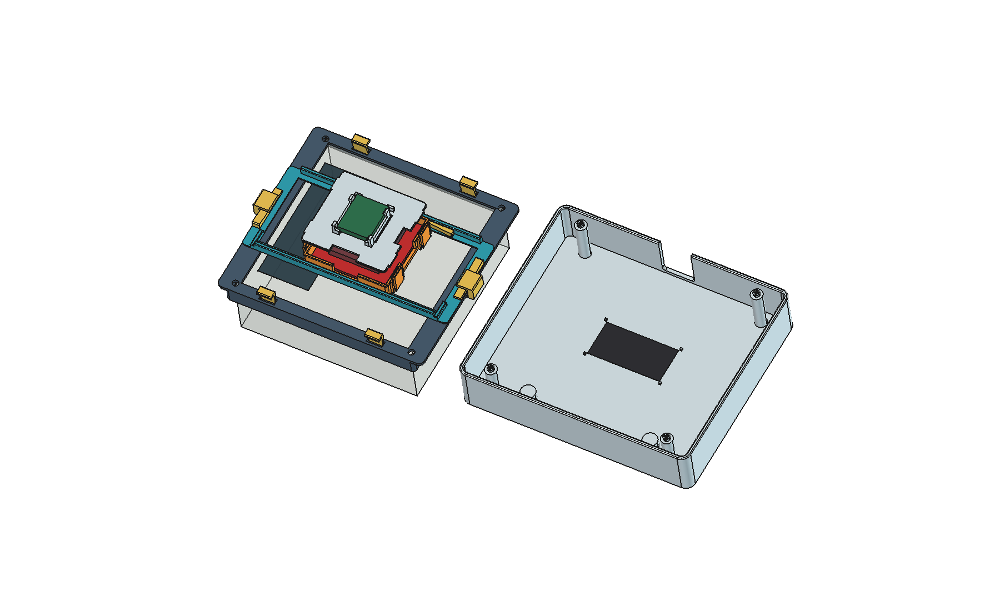

# NFC water meter enclosure v1.3

**[Read the English assembly guide](../../docs/assembly.md)** before printing.
There are nine STL part types, printed in 14 copies total. For a compatible v1.2
mount, the v1.3 snap-fit upgrade requires only parts **03** and **10**.

| File | Purpose |
|---|---|
| [`stl/`](stl/) | Nine STL files in their intended print orientations; units are mm |
| [`Vesimittari_NFC.FCStd`](Vesimittari_NFC.FCStd) | Complete assembly; outer cover initially hidden |
| [`Tulostusosat.FCStd`](Tulostusosat.FCStd) | All 14 printed pieces in print orientation, not a specific printer-bed layout |
| [`Havainne.FCStd`](Havainne.FCStd) | Exploded/illustrative arrangement for inspection |
| [`Vesimittari_NFC.step`](Vesimittari_NFC.step) | Neutral CAD assembly export of printed parts |
| [`tarkistus.json`](tarkistus.json) | Original dimensions, per-part quantities, and geometric checks |
| [`LUE_MINUT.md`](LUE_MINUT.md) | Original Finnish design and printing notes |
| [`../vesimittari_kotelo.FCMacro`](../vesimittari_kotelo.FCMacro) | Parameterized source generator |

Reference renders: [`nfc_kansi_esp32.png`](nfc_kansi_esp32.png),
[`mekanismi.png`](mekanismi.png), [`kotelo_suljettu.png`](kotelo_suljettu.png),
[`kokonaisuus.png`](kokonaisuus.png), and [`tulostusosat.png`](tulostusosat.png).

These are design exports, not a claim that v1.3 has been physically assembled
and tested. The snap arms, meter fit, cover friction fit, and RF performance must
be checked on the actual printed assembly. The enclosure has no IP rating.
